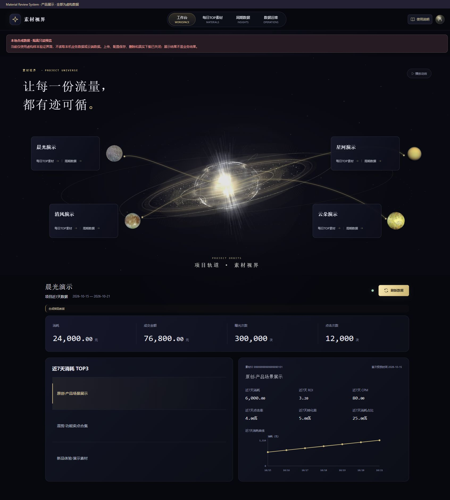
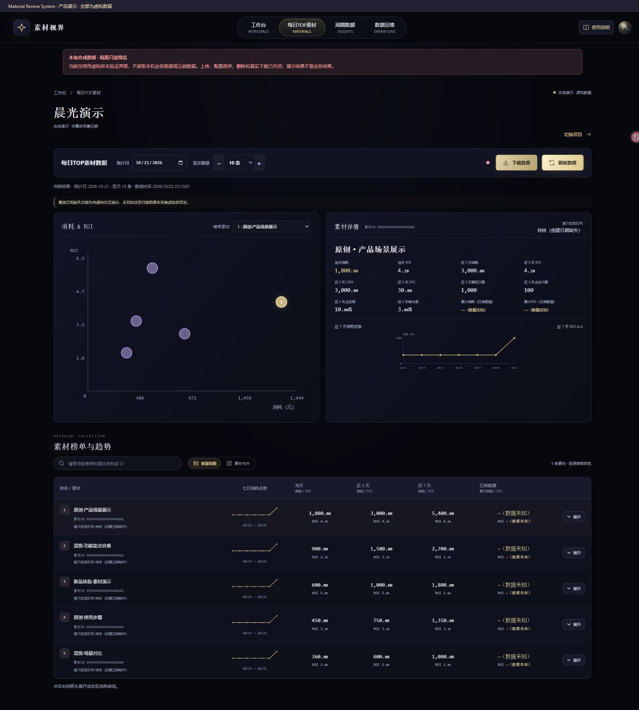
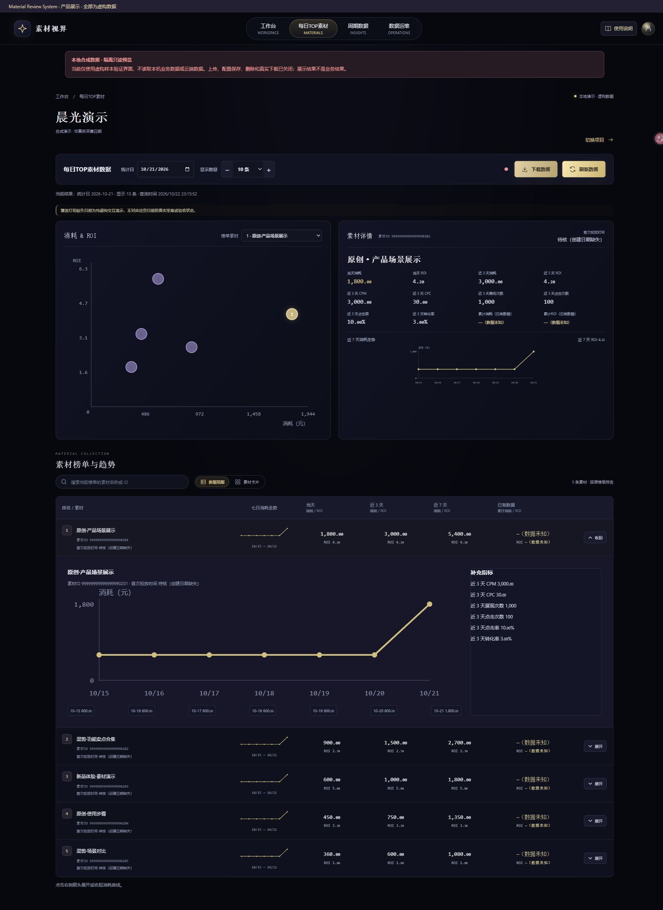
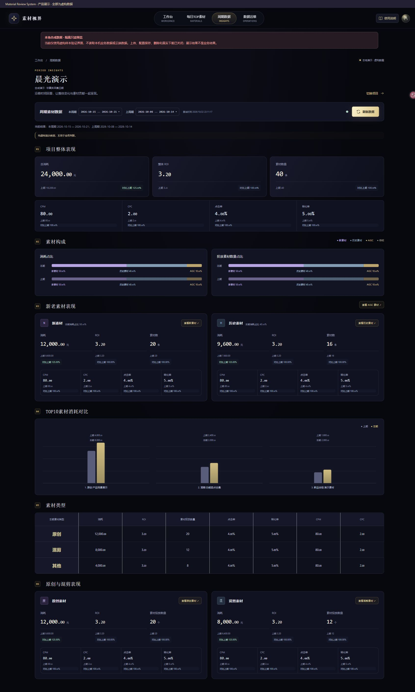
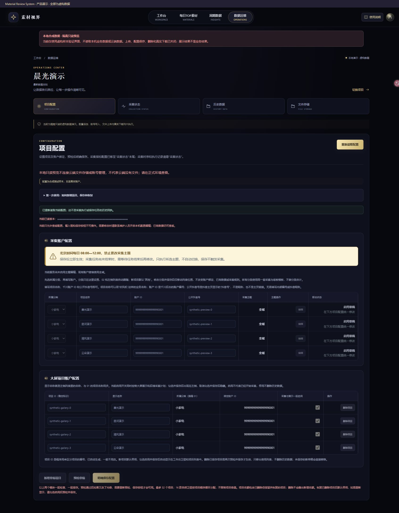
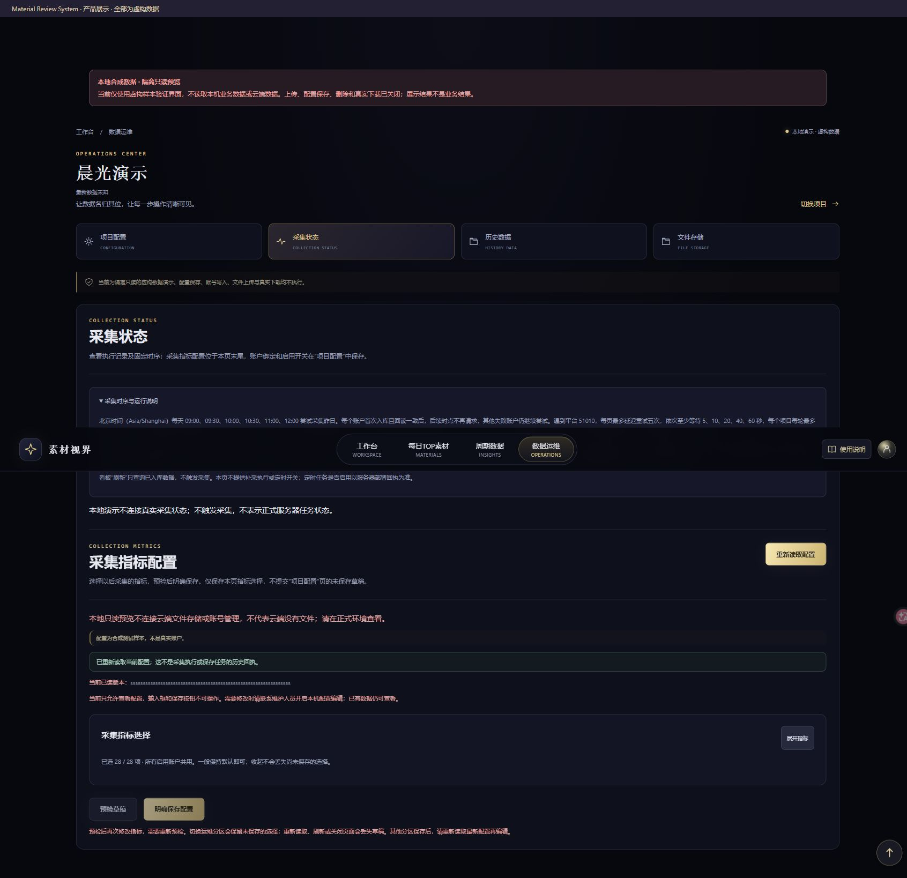
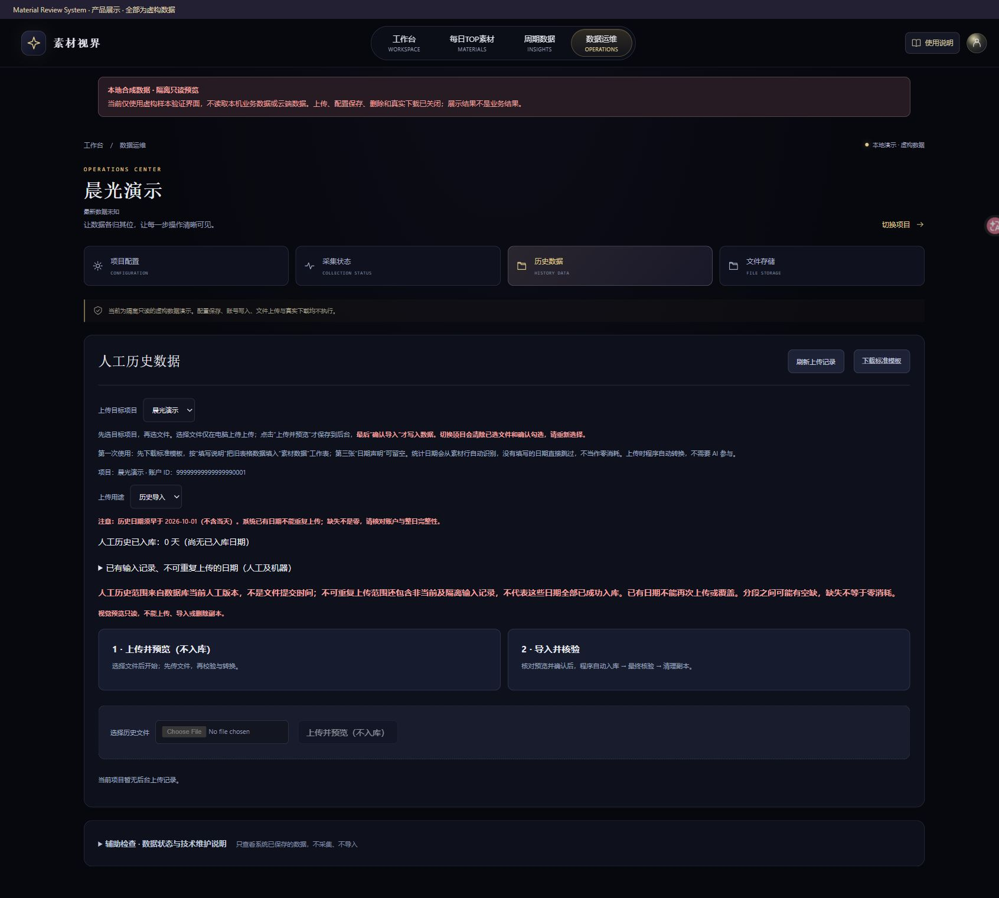
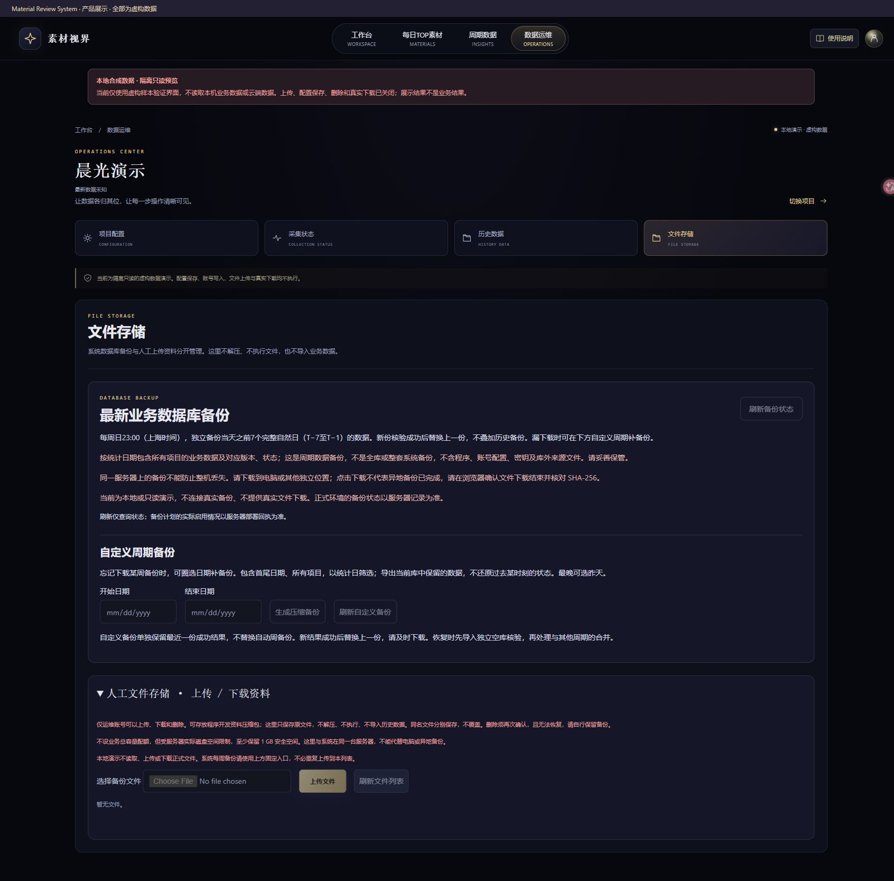

# Material Review System

素材投放数据分析系统的公开源码版本：Vue 3 / TypeScript 前端、Java 21 / Spring Boot 后端，以及 Python 采集、人工文件转换和压缩备份工具。

## 功能

- 项目工作台、每日 TOP 素材、消耗与 ROI 矩阵、周期复盘。
- 原创 / 混剪 / 其他统计，新老素材比较与明细导出。
- 全域 / 乘方采集配置，按稳定抖音号累计，版本化事实与防重复入库。
- 自动缺日补采、人工历史及缺日补录、采集状态。
- 按日期范围生成独立压缩 SQL 备份。

## 产品截图

以下截图使用公开源码的真实页面组件与纯合成数据。项目名、账户标识和金额均为虚构；不连接生产数据库。运维为隔离只读演示，不能代表正式任务或备份状态。点击图片可查看原图。

<details open>
<summary>工作台</summary>



</details>

<details>
<summary>每日 TOP 素材</summary>



</details>

<details>
<summary>素材详情</summary>



</details>

<details>
<summary>周期数据</summary>



</details>

<details>
<summary>项目配置</summary>



</details>

<details>
<summary>采集状态与指标</summary>



</details>

<details>
<summary>历史数据</summary>



</details>

<details>
<summary>备份与文件存储</summary>



</details>

## 目录

| 目录 | 内容 |
| --- | --- |
| `frontend` | 界面、接口适配、合成预览、测试与构建定义 |
| `backend` | 计算、API、入库校验、数据库迁移定义、测试及空白上传模板 |
| `contracts` | 字段映射、业务计算及数据接口契约 |
| `tools/collector` | 采集与补采逻辑、测试 |
| `tools/manual_history` | 人工文件转换与导出、测试 |
| `tools/maintenance` | 完整/周期压缩备份逻辑、测试 |

## 构建与测试

需要 Node.js 22、pnpm、JDK 21、Maven 3.9，以及 Python 3.11 或更高版本。

```sh
cd frontend
pnpm install --frozen-lockfile
pnpm build
pnpm test
cd ..
python -m pip install -r tools/dev/requirements-t06.txt
python -m pip install -r tools/dev/requirements-period-backup.txt
python tools/dev/prepare_public_test_fixtures.py
mvn -f backend/pom.xml test package
python -m unittest discover -s tools/collector -p 'test_*.py'
python -m unittest discover -s tools/manual_history -p 'test_*.py'
python -m unittest discover -s tools/maintenance -p 'test_*.py'
```

数据库集成测试需要显式配置隔离 MySQL；默认跳过。这些命令不启动 MySQL。

## 本地界面预览

在 `frontend` 运行 `pnpm dev`，访问终端给出的本机地址下的 `/gallery-preview.html`。这是合成数据演示，不是完整生产环境，不包含真实业务数据，也不证明线上页面或采集已通过验收。

## 部署范围与限制

这是经过脱敏的源码发行，不是生产服务器镜像或一键部署包。未包含数据库内容、账户配置、API 密钥、登录密码、证书、Nginx/systemd 配置、操作回执或内部交接资料。

独立部署需要配置自己的数据库、采集服务授权、运行目录、HTTPS 入口和调度。部分入口仍保留严格的路径、端口及配置文件布局校验；示例库名为 `material_dashboard`，示例工作根为 `/opt/material-perspectives`。不要直接执行历史 bootstrap 类来修改已有数据库；应先评审迁移定义并在隔离环境验证。前端预览不需要生产凭据。

源码支持免登录模式；若启用，访客也能操作数据运维及备份下载。部署者须自行决定访问范围并配置访问保护，不应把预览直接作为生产发布。

## 授权状态

本项目尚未授予 MIT 或其他项目整体开源许可证。公开可见不代表授权任意修改、分发或商用；需要相应授权请联系仓库所有者。

第三方组件保留各自许可证及来源，详见 `THIRD_PARTY_NOTICES.md`。其中第三方已有的 MIT 声明不代表本项目整体采用 MIT。

公开文件清单见 `PUBLIC_MANIFEST.json`，排除范围及脱敏说明见 `PUBLICATION_SCOPE.md`。
